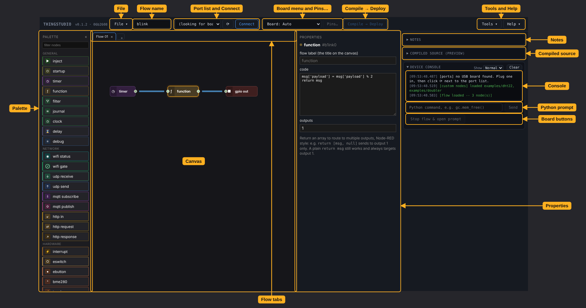

# Step 2: Tour the editor

Start Thingstudio if it isn't running: see [step 1](getting-started.md#start-thingstudio).

<figure markdown="span">
  <figcaption>The parts of the editor. Click to see it full size.</figcaption>
</figure>

<!-- The labels on the picture come from EDITOR_PARTS in tools/screenshots.py. Keep the names below in step. -->

## Toolbar

The toolbar runs left to right in the order you work: the flow, the board, then deploy.

- **New, open, save:** the **File** menu.
- **This flow's name:** saved with the flow. The board reports it, so you can tell which flow it's running.
- **Connect to a board:** pick the board's port from the list, then click **Connect**. **⟳** looks for boards
  again.
- **Board type, pin map:** the **Board** menu sets the board the flow is for; **Auto** uses the connected board.
  **Pins…** opens a page listing that board's pins.
- **Deploy flow to board:** **Compile → Deploy** turns the flow into MicroPython and sends it to the board.
- **Board tools, user guide:** the **Tools** menu has board jobs, such as installing the runtime or removing a flow.
  The **Help** menu opens this user guide.

## Palette

**Nodes to add:** every node, in groups such as **General**, **Network** and **Hardware**. Drag a node onto the
canvas, or click it. Type in the filter box to find one. [Custom nodes](custom-nodes.md) appear in the group they
name, or in **General**.

## Canvas

**Build the flow here.** **Sheets of this flow:** the tabs above the canvas spread one flow across several sheets.

The canvas works like this:

- **Wire two nodes:** drag from one node's output, on its right, to another node's input, on its left.
- **Select:** click a node or a wire. Ctrl-click to select several nodes.
- **Delete:** select, then press Delete or Backspace. Deleting a node removes its wires too.

The editor refuses a wire between ports whose types don't fit. See [Wiring](working-in-the-editor.md#wiring).

## Properties, notes and console

The right-hand side holds the selected node's settings and what the board sends back:

- **Selected node's settings:** the properties panel.
- **Notes on this flow:** the **Notes** panel, free text saved with the flow.
- **Generated MicroPython:** the **Compiled source** panel. Click it to open it.
- **Messages from the board:** the **Device console**, with messages from Thingstudio and the board, including your
  flow's output. Its **Show** menu sets how much it shows: **Normal** for your flow's output, results and errors,
  **Info** to add routine reports such as memory, **Debug** for everything.
- **Run Python on the board:** type a line of Python and click **Send**. It runs on the board alongside the flow.
  See [Commands and the Python prompt](debugging.md#commands-and-the-python-prompt).
- **Escape to REPL:** **Stop flow & open prompt** stops the flow and gives you MicroPython's own `>>>` prompt (the
  REPL). **Restart Thingstudio** starts the flow again.

[Editor in depth](working-in-the-editor.md) covers wire types, node labels, presets, config nodes and node status.

## Next

Step 3: [install MicroPython](installing-micropython.md) on your board.
