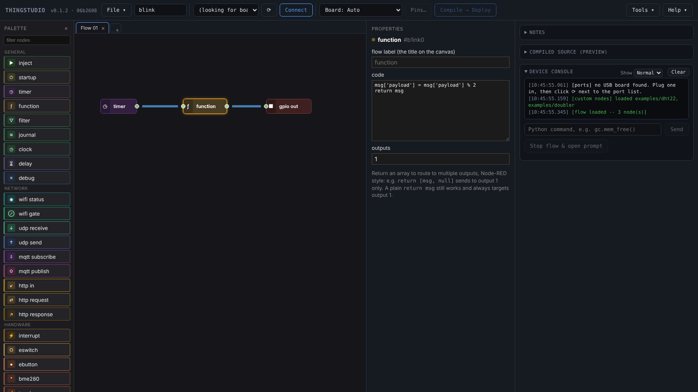

# ThingStudio

ThingStudio is a visual, low-code way to program microcontrollers. You build a program, called a flow, in a
node-based editor in your web browser. Nodes are functional blocks, and wires carry data between them. The design is
inspired by [Node-RED](https://nodered.org/).

ThingStudio converts the flow to [MicroPython](https://micropython.org/), a version of Python for microcontrollers,
compiles it, and sends it to your board. The flow is saved on the board. It will then run without the editor connected, and
will start again after a reset or power cycle.

<figure markdown="span">
  [](images/editor.png)<figcaption>The editor: nodes to drag in on the left, your flow in the middle, and on the right the selected
  node's settings and the board's console. Click to see it full size. [Tour the editor](editor-tour.md) labels every
  part.</figcaption>
</figure>

!!! tip "In a hurry?"
    [Getting started](getting-started.md) takes you from a new board to a blinking LED in six steps.

ThingStudio is designed to be private, and as open and hackable as possible:

- **Fully local.** Development happens on your computer. There's no cloud service and no account.
- **Works offline.** Once installed, it needs no internet connection, docs included.
- **Git friendly.** ThingStudio's files, your programs and your board definitions, are plain, indented
  JSON that you save where you like. They diff cleanly and sit happily in a git repository. Passwords and
  other credentials are stored separately, so a committed program holds no secrets.
- **Made to be extended.** Write your own [custom nodes](custom-nodes.md), and add your own
  [boards](boards.md#adding-a-board) and [processors](boards.md#adding-a-processor). You drop their files into
  a folder. There's nothing to rebuild.
- **Free and open source.** ThingStudio is under the
  [Apache 2.0 license](https://github.com/mkarliner/ThingStudio/blob/main/LICENSE). You can use it, change it and
  build on it, including in commercial products.

!!! tip "Already know the background?"
    If you know Node-RED, MicroPython or Arduino, read what's different for you, or go straight to
    [Getting started](getting-started.md).

    - [Node-RED](coming-from/node-red.md)
    - [MicroPython](coming-from/micropython.md)
    - [Arduino and C](coming-from/arduino.md)

## Who ThingStudio is for, and who it isn't

ThingStudio is designed for developers with a reasonable amount of programming experience, it doesn't aim to teach programming fundamentals.
You should also have some level of experience in working with microcontrollers. You don't have to be an EE graduate, but you should be comfortable wiring a breadboard. You should also be able to do basic commands from the terminal or PowerShell.

## What's different about programming with ThingStudio?

A typical microcontroller program, in Arduino for example, has a `setup()` section that runs once at boot, then a
main loop that runs forever. The loop might:

- read the sensors
- check the buttons
- update the outputs
- check the network
- go round again

Each new job makes the loop longer. A slow step, such as a network call, holds up everything else, and the timing
gets hard to reason about.

ThingStudio programs respond to events instead. When a button is pressed, turn on a light. Every ten seconds, read
the temperature. When a message arrives from the network, update the display. Each response runs only when its event
happens, and the board waits for many events at once. This is
[event-driven programming](background/event-driven.md).

MicroPython supports this style natively with
[`asyncio`](https://docs.micropython.org/en/latest/library/asyncio.html). An `asyncio` program no longer reads top to
bottom, which makes it harder to see what it does. ThingStudio's graphical editor of events, functions and outputs
makes an event-driven program easier to build and follow.

## Events, nodes and wires

A program is made of **nodes** joined by **wires**. There are three types of node:

- **Sources** start messages when something happens: a timer fires, a button is pressed, an MQTT message arrives.
- **Transforms** take a message in and send a message on: a function, a filter, a delay.
- **Sinks** act on a message: switch a pin, update a display, publish to MQTT.

A wire joins one node's output to the next node's input. The nodes and wires together make a **flow**. A flow can
hold any number of chains, each starting at a source.

Nodes pass **messages** along the wires. A message is a dict, with its main value in `payload`. Messages are covered
in more detail in [flows, nodes and messages](background/flows-and-nodes.md).

This way of working comes from [Node-RED](background/node-red.md), a popular tool for home automation and IoT. In
Node-RED, flows run on a server or a Raspberry Pi. In ThingStudio, they run on the microcontroller.

## Including your own code

There are a number of ready made functions available built-in [nodes](nodes/index.md) . There is also the
[function](nodes/function.md) node, which will take regular MicroPython and runs your it on each message that arrives:

```python
# payload arrives in degrees C, leaves in degrees F
msg['payload'] = msg['payload'] * 1.8 + 32
return msg
```

`msg` is a dict, with the main value in `msg['payload']`. Return it to pass it on, or return nothing to stop it. A
function node can also keep state between messages and have more than one output. The only rule to remember is not to use blocking calls in a function node, that would make the entire flow wait on the operation.

To reuse code across flows, make it a [custom node](custom-nodes.md). A custom node has its own place in the palette
and its own properties in the property panel. It can access custom hardware, transform messages, act on them, or send them on a schedule.

You can also stop the flow and run the python REPL directly on the board from the editor for debugging. See
[Commands and the Python prompt](debugging.md#commands-and-the-python-prompt).

## Running on the board
The microcontroller runs a [MicroPython](background/micropython.md) image with a ThingStudio runtime on top. You can flash the image from the editor or use one of your own choosing. The runtime sends the flow to the board and manages running it.  It also sends back status and debugging information. We also provide custom Micropython images with the runtime included, which are more efficient in memory usage.

When you click **Deploy**, the editor converts your flow into MicroPython and compiles it. It sends the compiled flow to
the board over USB or WiFi, and the board swaps it in, and starts running it. There's no new firmware to flash, so
changing a flow and trying it again takes seconds. The board keeps the flow and runs it again after a restart.

## Built on standard parts

ThingStudio tries not to reinvent the wheel.

- MicroPython's [`asyncio`](https://docs.micropython.org/en/latest/library/asyncio.html) provides the event-driven
  primitives.
- Tried and tested libraries provide extra functionality and hardware drivers, such as Peter Hinch's
  [`mqtt_as`](https://github.com/peterhinch/micropython-mqtt) and
  [`micropython-async`](https://github.com/peterhinch/micropython-async), and drivers from
  [`micropython-lib`](https://github.com/micropython/micropython-lib).
- What comes out is plain MicroPython. You can read it in the editor's **Compiled source** panel.

## What you need

- A board with one of the processors in [Supported hardware](supported-hardware.md). Other boards that run
  MicroPython may work.
- A USB cable that carries data, not only power.

## Next

[Getting started](getting-started.md) lists the steps from a new board to a blinking LED, and starts you on the first
step.

The docs on [docs.thingstudio.net](https://docs.thingstudio.net/) follow the latest code. The docs installed with ThingStudio
(**Help → User guide**) match the version you have installed.
