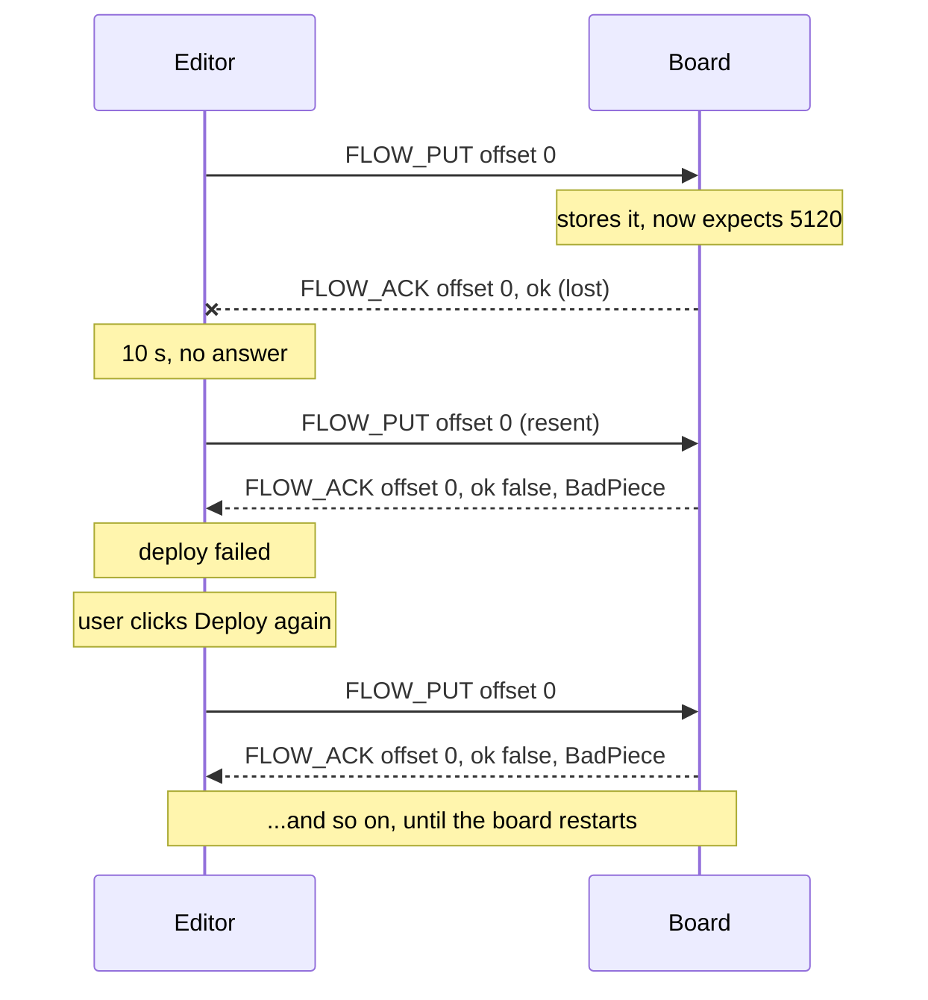

# Board ↔ editor protocol audit — 2026-10-24

A review of the wire protocol between the editor and the board, done at commit `38d5971` (runtime and
editor 13.0.0, protocol v1). It records findings, not decisions, as the reviews folder's README says.

Companion documents, both kept current rather than dated:

- `interfaces/protocol/SEQUENCES.md`: every exchange as a sequence diagram, with the faults below marked
  **⚠**. **This is the place to check the findings by eye.**
- `interfaces/protocol/COVERAGE.md`: generated per-message matrix (`tools/protocol_coverage.py`, now
  part of `make test`).

## How this was done

- Read the spec (`interfaces/protocol/`), the editor's protocol code and its deploy, library, board-settings
  and board-tools code in `editor/src/app/main.ts`, the board's `listener.py`, `messages.py`,
  `framing.py`, `deps.py` and `net_transport.py`, and the backend relays.
- Built MicroPython's unix port and `mpy-cross` from upstream (not the project's pinned commit) in a scratch
  workspace, outside your checkout. Ran the board conformance suite (5/5 pass) and
  `test_listener_integration.py` (26/26 pass).
- Reproduced each board-side finding against the real listener. The script is in the repo as
  `device-runtime/test/audit_protocol_exchanges.py` and prints PRESENT or fixed for each finding. At this
  commit, all six print PRESENT.
- I did not run the editor or backend test suites. The project rules say not to run them against the shared
  checkout, and the editor-side findings come from reading the code, as noted on each one.

## Summary

**The message shapes are in good order.** All 23 ids agree across `messages.json`, `messages.ts` and
`messages.py`. Every message has a spec section and conformance vectors. Both decoders survive garbage
without crashing, and the framing has adversarial tests. The coverage matrix shows no gaps.

**The faults are in the exchanges, and three of them are serious.** Each starts from one lost or refused
message during a deploy, and none of them is reported as what it is:

1. A resent flow piece is refused, and from then on **every deploy fails** until the board restarts.
2. The same for libraries: one refused piece makes that library **un-installable** until a restart.
3. A deploy refused for a missing library still **overwrites the saved flow**. After the next power cycle
   the board runs nothing, while the editor was told the old flow is still running.

**Why tests didn't catch this.** The spec and the vectors define what a message looks like. Nothing defines
the conversation: which reply answers which request, what may be resent, and what state a failure leaves
behind. Those rules exist only in `main.ts` and `listener.py`, and no conformance vector or shared test
exercises them. The editor's deploy sequence in `main.ts` has no test at all. The coverage matrix shows that
no editor test mentions `FLOW_PUT`, `FLOW_COMMIT` or `FLOW_ACK`.

## Findings

| # | Severity | In one line | Evidence |
|---|---|---|---|
| 1 | High | After a resent `FLOW_PUT` or any refused commit, every later deploy is refused, until a restart | reproduced |
| 2 | High | A resent `DEP_PUT` is refused, and that library stays refused until a restart | reproduced |
| 3 | High | A chunked deploy refused for a missing library still replaces the saved flow | reproduced |
| 4 | Medium | A `DEPLOY_ERROR` sent while pieces are still going can be reported as the deploy's result, while the board then runs the flow | code reading |
| 5 | Medium | Replies carry no request id, and USB and WiFi both see every reply | code reading |
| 6 | Low | An unknown message type gets a `FLOW_ACK Garbled` instead of being only logged, as the spec says | reproduced |
| 7 | Medium (spec) | The spec defines messages but not exchanges, reply rules, timeouts or the error codes the editor acts on | reading |
| 8 | Low (spec) | The backend leg (WebSocket JSON control messages, `TSAUTH1` handshake) isn't in the spec | reading |
| 9 | Low (spec) | Two statements in the spec claim more than the code does | reading |
| 10 | Low | `FLOW_PUT` doesn't check that a piece fits inside `total` (`DEP_PUT` does) | reading |

Today's workaround for 1 and 2 is Tools → Restart board (soft). It resets the listener's memory of the
transfer.

---

### 1. A resent flow piece is refused, and so is every later deploy (High)

Diagram: `SEQUENCES.md` §4, middle branch.

**What happens.** The board keeps one counter, `_flow_put_received`, and accepts a piece only when its
offset equals that counter (`listener.py` `_handle_flow_put`). The counter goes back to 0 only when a deploy
completes, or when renaming the file at commit fails. It does not reset when a piece at offset 0 arrives.
So:

- If the board stored a piece but the editor never got the `FLOW_ACK`, the editor's resend has the old offset
  and is refused as `BadPiece`. The editor treats `BadPiece` as final.
- The counter is still at the old value, so the next deploy's first piece (offset 0) is refused too. So is
  every deploy after that, until a restart. On a board with native USB, reconnecting doesn't reset it.
- The same thing happens after a commit is refused for `Incomplete` or `MissingDependency`: neither path
  resets the counter (reproduced). After `MissingDependency` the editor's advice is "Deploy again to send the
  missing libraries", and that next deploy is **guaranteed** to fail with `BadPiece`.

**When it bites.** Any refused commit (above), or a lost acknowledgement, not a lost piece: since 12.1.0 a garbled piece gets an
immediate `FLOW_ACK Garbled` and the resend works. A *slow* acknowledgement happens to recover: the late
`ok` satisfies the resend's wait, and the board's `BadPiece` reply to the resend arrives with no one waiting
for it. So this needs board-to-editor bytes to be lost. How often that happens on the USB-UART boards (CYD)
is unknown. Losses in the other direction are documented on the CYD (2026-10-22).

**What would fix it, with no change to message shapes.** Make a piece safe to send twice: accept any offset
no greater than what has been stored, write from that offset, and treat offset 0 as starting over. The editor's
comment on library pieces already assumes this ("Resending is safe: … rewrites from that offset"), so this
brings the board in line with it. The spec doesn't say what a repeated piece means. That rule belongs in the
spec, which needs your OK (finding 7).

### 2. A resent library piece is refused, and the library stays refused (High)

Diagram: `SEQUENCES.md` §6, second diagram.

**What happens.** Same cause as 1, in `deps.put_chunk`: a piece at any offset other than 0 must equal the
bytes already written. A second problem makes it stick. When a piece fails, `listener.py` records the library
as failed (`_dep_put_errors[name]`) and refuses **every** later piece of that library, offset 0 included,
until a `DEP_COMMIT` for it arrives. After a refused piece the editor stops and never sends that
`DEP_COMMIT`. So every later deploy of a flow that uses the library fails at its first piece, until a restart.
Reproduced: after one resent piece, a fresh offset-0 piece gets `BadPiece` with the old error text.

**Also wrong.** The comment in `main.ts` (`installFlowDependencies`) says resending a `DEP_PUT` is safe. On
the board it isn't, for any offset except 0.

**Fix.** As in 1, plus clear the library's recorded failure when its offset-0 piece arrives.

### 3. A refused chunked deploy still replaces the saved flow (High)

Diagram: `SEQUENCES.md` §5, second branch.

**What happens.** `_handle_flow_commit` renames the received file over `/_flow.mpy` first and only then calls
`_deploy_flow`, which checks the flow's libraries. When a library is missing, the board answers
`DEPLOY_ERROR MissingDependency`, and the old flow keeps running in memory. `HELLO` keeps naming it. But the
file on flash is now the refused flow. At the next reset or power cycle the board loads that file, fails on
the missing import, and runs nothing. `HELLO` then reports no flow. Reproduced exactly.

The whole-flow `DEPLOY` didn't have this problem: it checked the libraries before writing anything. The bug
came in with chunked deploy (11.3.0), which became the only path in 12.0.0.

**When it bites.** The editor installs libraries before every deploy, so a missing library is uncommon. It
happens when the editor's idea of the board's libraries is wrong: another editor changed them, or a library
write failed. The editor's own handling of `MissingDependency` exists for exactly those cases.

**Fix.** Check the libraries before the rename, or keep the received flow in `.tmp` until the checks pass.

**Related spec wording (finding 9).** SPEC §5 says a failed deploy "changes nothing". That holds while the
flow is being received. It doesn't hold once the new flow is starting: by then the old flow has been stopped,
so an import error or a `MemoryError` at that point leaves nothing running. That may well be acceptable, but
the spec should say it.

### 4. An early `DEPLOY_ERROR` can become the deploy's result (Medium, code reading)

Diagram: `SEQUENCES.md` §5, last diagram.

**What happens.** `attemptDeploy` in `main.ts` starts waiting for `DEPLOY_ACK`/`DEPLOY_ERROR` *before* it
sends the first piece. When a piece can't be decoded for lack of memory, the board sends both a
`FLOW_ACK Garbled` and a `DEPLOY_ERROR MemoryError` (`_dispatch_locked`, and `_report_receive_oom` on the
read path). The Garbled ack makes the editor resend the piece, which may now fit. Meanwhile the
`DEPLOY_ERROR` has already satisfied the result wait. The editor finishes the pieces, sends `FLOW_COMMIT`, and
immediately reports "deploy failed: MemoryError". The board then starts the flow and sends a `DEPLOY_ACK`.
That ack appears in the console with nothing waiting for it.

Not reproduced: it needs a real `MemoryError` while decoding.

**Fix (editor only).** Start the result wait just before sending `FLOW_COMMIT`. Treat a `DEPLOY_ERROR`
during the pieces as ending the deploy on purpose, rather than as a stray result.

### 5. No request ids, and two transports see one stream (Medium, code reading)

Diagram: `SEQUENCES.md` §2, the note at the end.

Replies are matched by type and a field or two (offset, name), never by an id. The board writes every message
to USB and mirrors it to the WiFi session. Both transports also share the board's single in-progress transfer
state (finding 1's counter). So with one editor on USB and another on WiFi:

- The `HELLO` the board sends when a WiFi session starts reaches the USB editor too. If that editor is
  deploying, it reads the `HELLO` as "the board restarted while starting the flow" (`attemptDeploy` accepts a
  `HELLO` when no `HELLO_REQUEST` is pending).
- Two deploys at once interleave pieces into one temporary file.

Two editors on one board is unusual, and the dispatch lock keeps the board itself safe. A proper fix (request
ids, or the board refusing a second transfer source mid-deploy) changes the interface, so it is your call. At
minimum the spec should say that one editor at a time is assumed.

### 6. An unknown message type is answered as if it were a garbled flow piece (Low)

SPEC §6 says an unknown type byte "is ignored and logged, never fatal". The board logs it, but it also goes
through the "couldn't read that line" path, which sends a `FLOW_ACK Garbled` (reproduced). That's harmless
today. A future editor that sends a new message type mid-deploy to an older board would see it as a garbled
piece and resend. **Fix:** in `_dispatch_locked`, send the Garbled ack only for a line that couldn't be
decoded, not for a known-good frame with an unknown type.

### 7. The spec has no exchanges (Medium, spec)

This is the root cause behind 1–4. What the spec does not say, and the code depends on:

- **Which message answers which.** Examples: `FLOW_PUT` → `FLOW_ACK` with the same offset; `FLOW_COMMIT` →
  exactly one `DEPLOY_ACK` or `DEPLOY_ERROR`; `SET_BOARD_SETTINGS` → `BOARD_SETTINGS_RESULT` then `HELLO`;
  `TRIGGER`, `EXEC`, `RESTART` and `STOP_TO_PROMPT` → nothing.
- **What the board may send unasked:** boot `HELLO`, session-start `HELLO`, `NODE_ERROR`, `NODE_STATUS`, and
  the stray `FLOW_ACK Garbled` / `DEPLOY_ERROR MemoryError`.
- **What may be resent,** and what state a failure leaves behind (findings 1–3).
- **Timeouts:** the editor waits 3 s for a `HELLO`, 10 s per piece with 2 resends, 30 s for a commit, 10 s for
  board settings and 20 s after a restart. The board allows 90 s idle on WiFi; the backend sends a keepalive
  every 30 s.
- **Error codes the editor acts on.** `Garbled` triggers a resend. `MissingDependency`, `ImportError` and
  `MemoryError` select advice. Other codes the board sends: `BadPiece`, `WriteFailed`, `Incomplete`,
  `NoSpace`, `BadName`, `Unsupported`, plus any Python exception name. None of these strings is in the spec,
  so renaming one on the board would silently change the editor's behaviour.
- **`authScheme` values.** The board sends `"none"` or the scheme name.

**Recommendation.** Add an "Exchanges" section to `SPEC.md`: the reply rules, the resend rule, the error-code
table, and a pointer to `SEQUENCES.md` for the pictures. Then add *exchange* vectors: short scripted
conversations, such as "piece, lost ack, resend → ok", run against the listener the way
`test_listener_integration.py` already drives it. Move the editor's deploy sequence out of `main.ts` into a
module that can be tested against the same scripts. Adding to the spec is changing the interface, so all of
this waits for your go-ahead.

### 8. The backend leg isn't specified (Low, spec)

`interfaces/README.md` lists the protocol as "editor ↔ backend ↔ device", but `SPEC.md` covers only the frames.
Two things exist only in code comments: the WebSocket's JSON control messages (`list_ports`, `connect`,
`discover`, `disconnect`, `install_runtime`, `remove_flow`, `raw_write`, and the `status`, `ports`,
`debug` and install-progress replies) and the WiFi handshake (`TSAUTH1` challenge and response, `TSAUTH
OK/FAIL/BUSY/NOPASSWORD`, keepalive, idle close). §6 gives the handshake one sentence. Both are drawn in
`SEQUENCES.md` §1–2 as they stand.

### 9. Two spec statements claim more than the code does (Low, spec)

- SPEC §5: "a board that predates 11.3.0 is refused by the major-version gate before anything is sent". True
  only if a `HELLO` arrived during this connection. Without one, the editor logs "deploying without a version
  check" and sends anyway.
- SPEC §5: a failed deploy "changes nothing". See finding 3.

### 10. `FLOW_PUT` has no bounds check (Low)

`_handle_flow_put` checks `offset > total` but not `offset + len(data) > total`. `deps.put_chunk` checks
both. An oversized piece is caught only at commit, as `Incomplete` with a misleading byte count.

## What is sound

- One message table, and three implementations that agree with it, now checked on every `make test`.
- The decoders never raise on bad input. A stalled frame is reset after five non-progressing reads. A
  garbled line is answered in one round trip instead of after three timeouts.
- Every editor wait has a timeout, and a disconnect cancels all pending waits.
- The deploy has one fixed sequence with no recovery chain. The faults above are gaps in that sequence, not
  an argument for adding recovery.
- WiFi sessions are authenticated without the password crossing the network. Settings are USB-only, one
  session at a time, and failed attempts are slowed down.

## The underlying cause

Findings 1–4 have one shape. The message layer is formal (one table, validators, vectors), but the
conversation layer is not. On the board, the protocol state is a few module globals that each handler changes
as it sees fit. On the editor, the state is wherever an async function in `main.ts` happens to be waiting.
Nothing lists the states or says what each message does in each state, so a missing transition (for example,
"offset 0 while part-way through a transfer") can only be found by tracing every exit from every handler.
Mike, 2026-10-24: implement the conversation as an explicit state machine, specified in `SPEC.md` and tested
by exchange vectors on both sides. That work is on the `protocol-state-machine` branch.

## Recommended order

1. Fix 3 (board, small: move the check before the rename). It is the only finding that loses a working
   flow.
2. Fix 1 and 2 together (board: make a piece safe to resend, offset 0 starts over, clear a library's failure
   on its offset 0). Re-run `audit_protocol_exchanges.py`; it should then print "fixed".
3. Fix 4 (editor: start the commit wait at the commit).
4. Fix 6 and 10 (board, a few lines each).
5. With your go-ahead: the spec's Exchanges section and exchange vectors (7), then 8, 9 and a decision on 5.

Fixes 1–4, 6 and 10 change implementations only, not message shapes, which the interface rules allow.
Writing the resend rule into the spec is your call.

## Re-running this audit

Write a new dated review rather than editing this one.

1. `python3 tools/protocol_coverage.py --check`. Message-level drift: ids, spec sections, vectors,
   senders, handlers, diagrams.
2. `MICROPYTHON_BIN=… MPY_CROSS_BIN=… python3 device-runtime/test/audit_protocol_exchanges.py`. These
   findings, PRESENT or fixed.
3. Take each diagram in `SEQUENCES.md` and walk it against the code: board side in `listener.py`
   (`_dispatch_locked` and the `_handle_*` functions), editor side in `main.ts` (`attemptDeploy`,
   `sendFlowPieces`, `installFlowDependencies`, `requestHelloOrExplain`, `waitForBoardBack`, the
   board-settings dialog). Fix the diagram wherever it is wrong.
4. For every exchange, ask:
   - Does every request have a bounded wait?
   - Is every resend safe to repeat?
   - After any failure, can the next attempt start cleanly without a restart?
   - Does the editor report what actually happened on the board?
   - Is every reply the editor relies on (type, code string, field) written in the spec?
