# Wire protocol — exchanges, as sequence diagrams

`SPEC.md` says what each message looks like. This file shows **how they are used together**: who sends
what, what answers it, and what happens when something goes wrong. It describes what the code does today
(editor `editor/src/app/main.ts`, board `device-runtime/src/listener.py`, backend
`backend/src/thingstudio_backend/{ws_relay,tcp_relay}.py`), including its known faults. Those are marked
**⚠** and numbered after the findings in the latest protocol audit
(`docs/working-notes/reviews/2026-10-24-protocol-audit.md`).

The diagrams are Mermaid and render on GitHub and in VS Code's Markdown preview.

**Keeping this current.** `tools/protocol_coverage.py` (run by `make test`) fails if a message in
`messages.json` appears in no diagram here, or a diagram names a message that doesn't exist. It cannot tell
whether a diagram is *right*. When you change an exchange, change its diagram in the same commit. The
convention the check relies on: on an arrow line, an **unquoted ALL-CAPS first word is a message name**
(`E->>B: FLOW_PUT offset, data`). Anything that isn't a protocol message (backend JSON, the WiFi
handshake's text lines, printed console lines) starts with a quote or lower case.

Participants: **Editor** (the browser app), **Backend** (the local relay, only when connected through it),
**Board** (the listener on the device). The backend moves frames verbatim and never decodes them, so most
diagrams leave it out: an arrow straight from Editor to Board passes through it unchanged.

Contents:

1. [Connect over USB](#1-connect-over-usb)
2. [Connect over WiFi](#2-connect-over-wifi)
3. [Deploy a flow — the normal path](#3-deploy-a-flow--the-normal-path)
4. [Deploy a flow — when a piece goes wrong](#4-deploy-a-flow--when-a-piece-goes-wrong)
5. [Deploy a flow — when the commit fails](#5-deploy-a-flow--when-the-commit-fails)
6. [Install a library](#6-install-a-library)
7. [Change board settings](#7-change-board-settings)
8. [Commands with no reply](#8-commands-with-no-reply)
9. [Things the board says unasked](#9-things-the-board-says-unasked)
10. [Old and reserved messages](#10-old-and-reserved-messages)

---

## 1. Connect over USB

The board sends a `HELLO` when its listener starts, but the editor has usually not connected yet, so on
Connect the editor always asks for one. No reply within 3 s doesn't stop Connect; the editor works out
from what the board did print what is probably wrong.

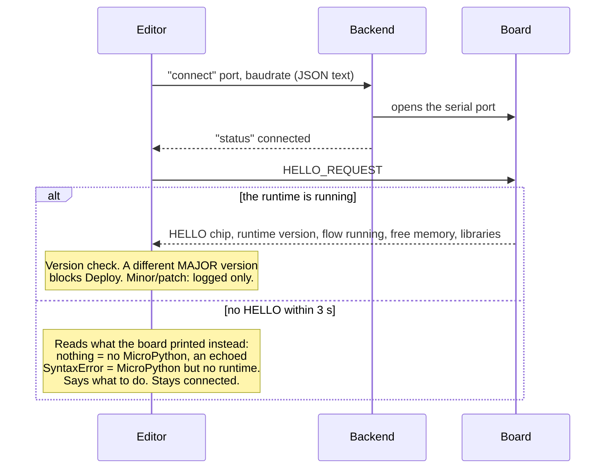

Direct WebSerial (no backend) is the same without the backend's two steps.

## 2. Connect over WiFi

Only through the backend. The board speaks first, with a challenge; the password never crosses the
network. One WiFi session at a time. USB stays live alongside it.

⚠ **Finding 5.** Everything the board sends goes to USB *and* to the WiFi session. Replies carry no request
id, so an editor on USB and one on WiFi each see the other's replies, and the `HELLO` sent when a WiFi
session starts can land in the middle of the other editor's deploy.

## 3. Deploy a flow — the normal path

The editor sends the flow in 5 KB pieces, each answered, then a commit. The board writes pieces to a
temporary file, so a big flow never needs one big block of memory.

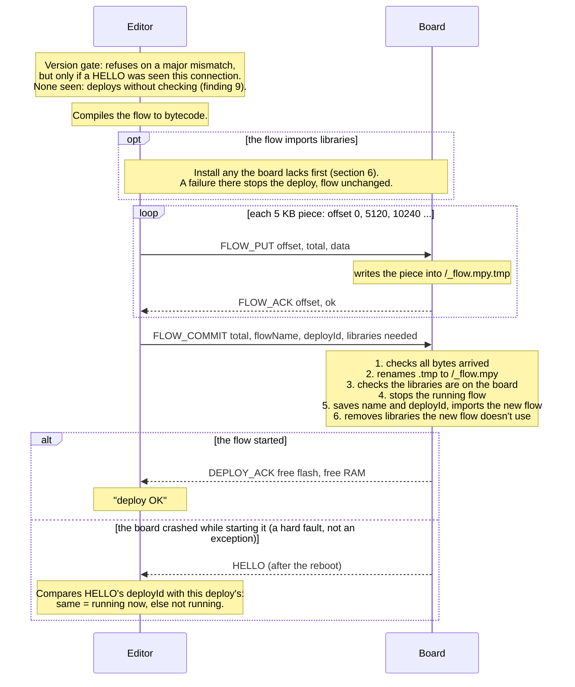

The editor waits up to 30 s for the answer to the commit.

## 4. Deploy a flow — when a piece goes wrong

Each piece gets up to three tries. What happens depends on why the editor didn't get an `ok`.

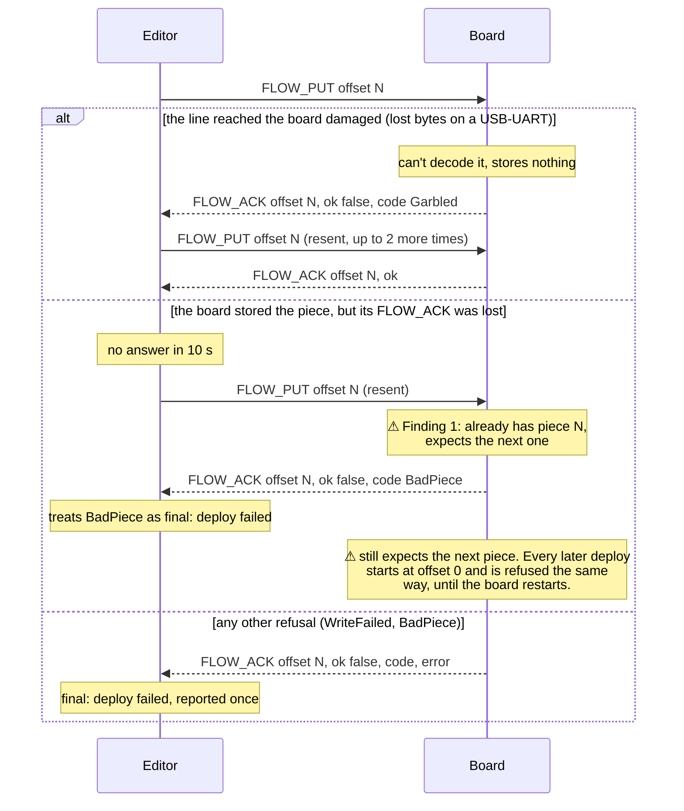

## 5. Deploy a flow — when the commit fails

The board answers a commit with exactly one `DEPLOY_ACK` or `DEPLOY_ERROR`. The editor reports the
error once, with advice. Nothing is retried, and the board never frees memory or restarts by itself to make a
retry fit.

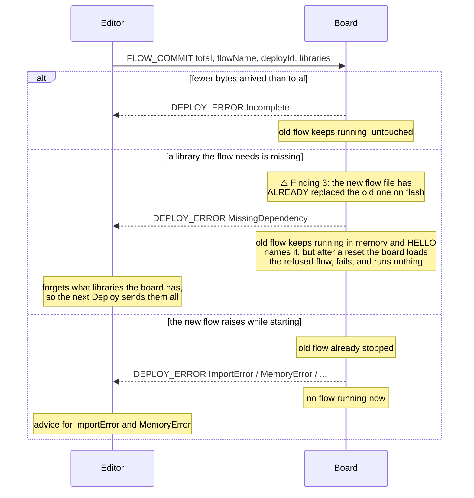

There is one more way to get a `DEPLOY_ERROR`, while pieces are still being sent: a piece the board has no
memory to decode.

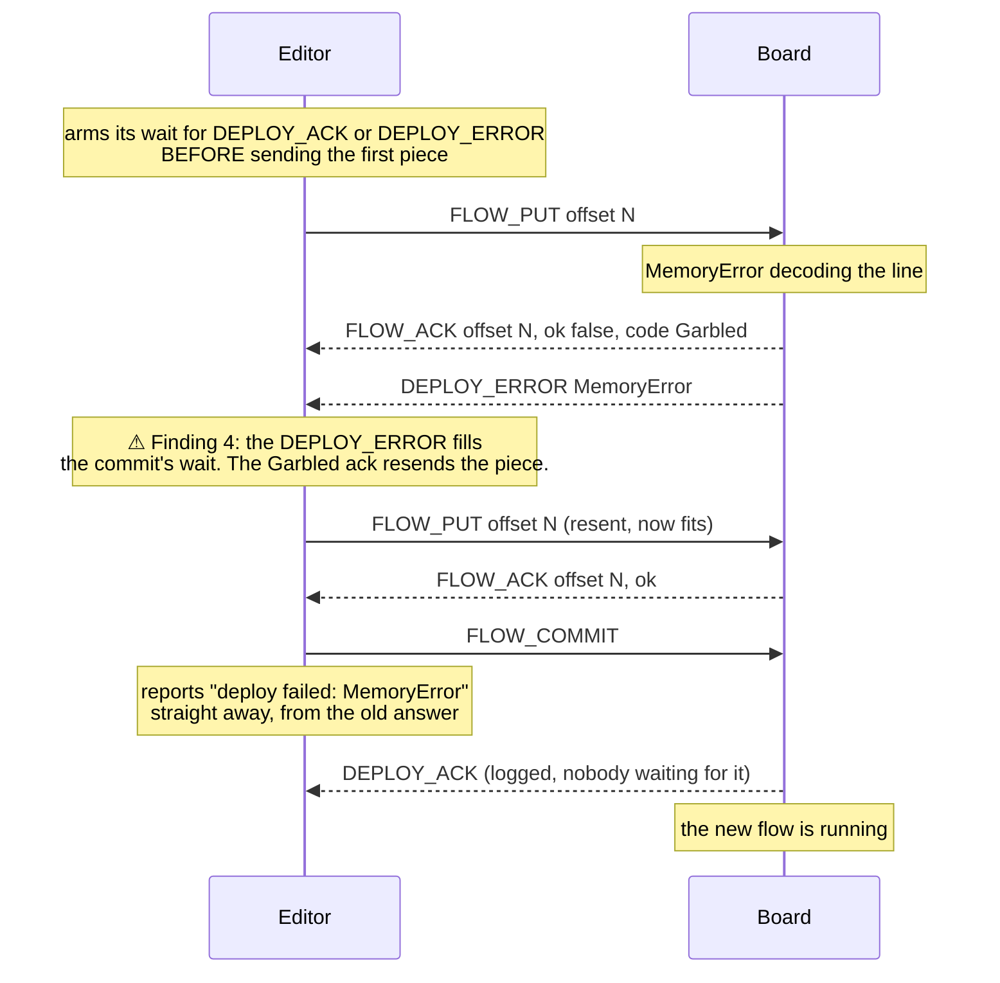

## 6. Install a library

Before a flow that imports libraries is deployed, the editor compares each library's hash with the list the
board gave in `HELLO` and sends only the missing or changed ones. Same pattern as a flow: 5 KB pieces, each
answered, then a commit.

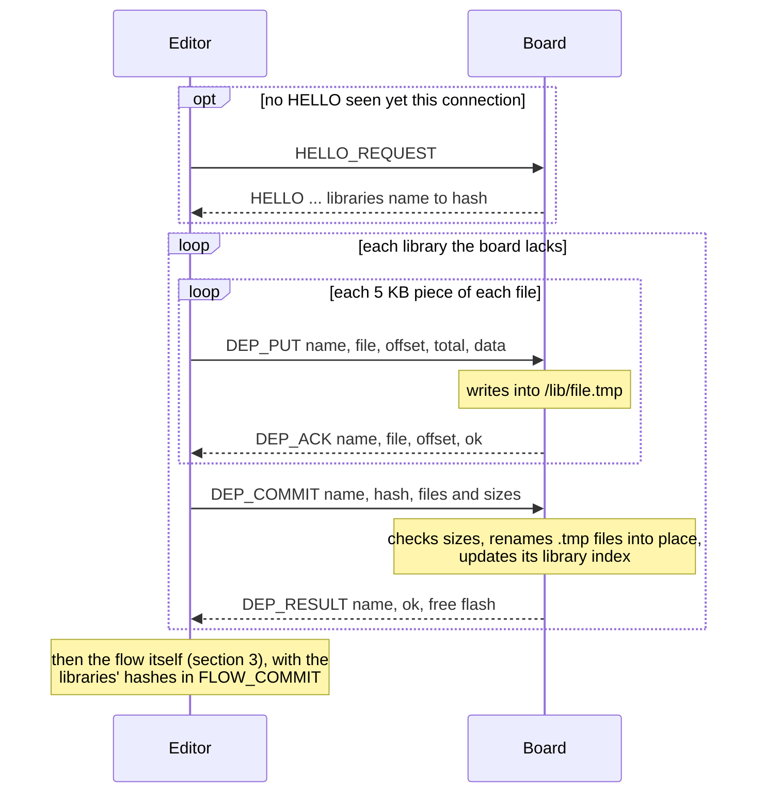

What goes wrong:

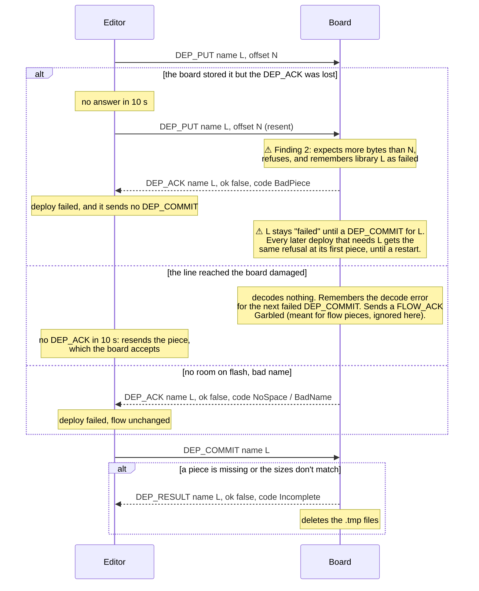

## 7. Change board settings

Hostname and WiFi password. **USB only**: the password is what makes a WiFi session trusted, so it can't be
changed over WiFi.

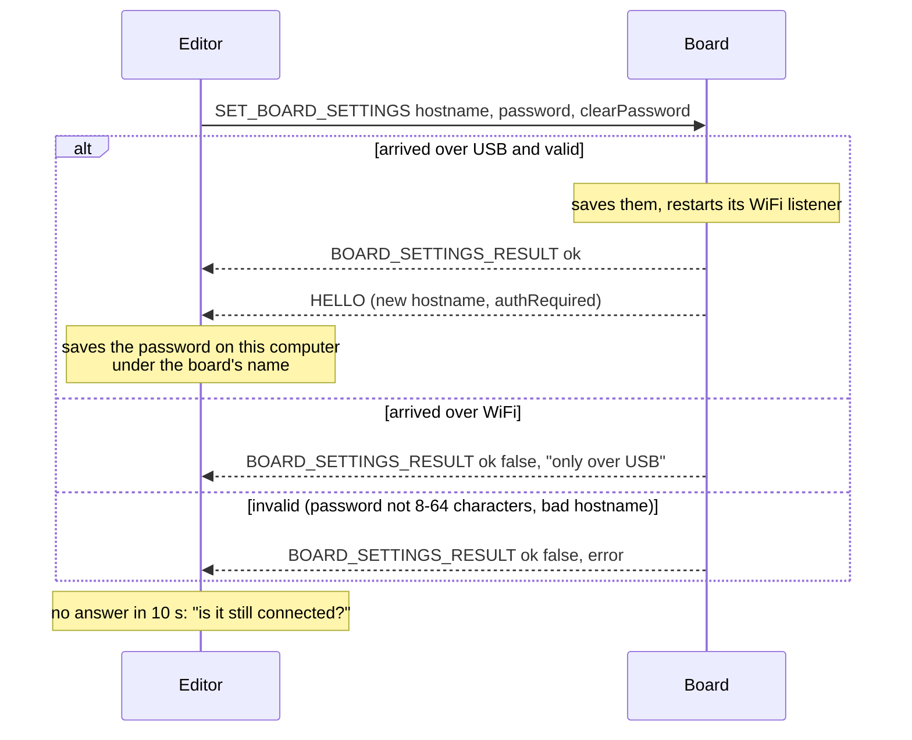

## 8. Commands with no reply

These four have no answering message. What the editor sees is what the board prints, or the `HELLO` after a
restart.

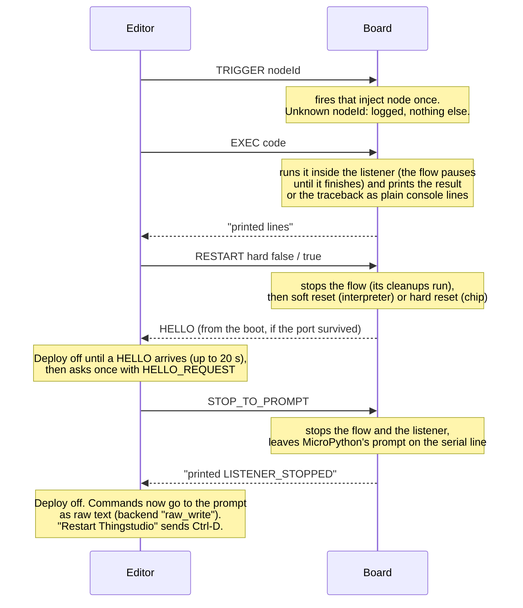

`STOP_TO_PROMPT` is also sent before Install runtime and Remove flow, so the board lets go of the port.

## 9. Things the board says unasked

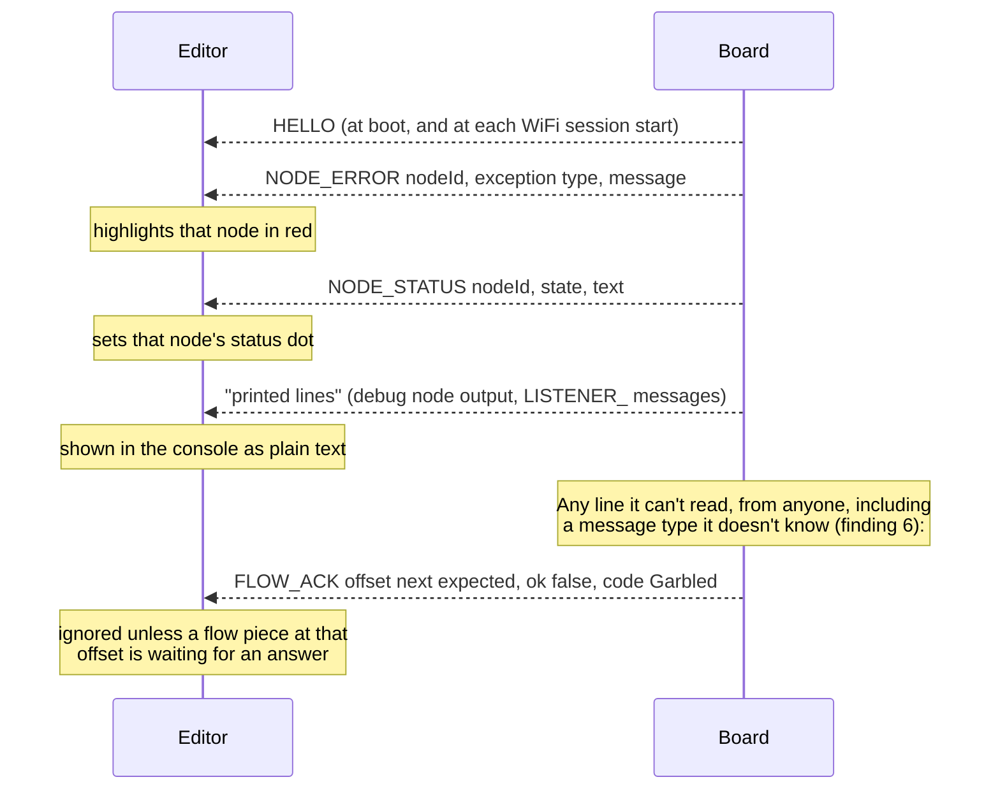

## 10. Old and reserved messages

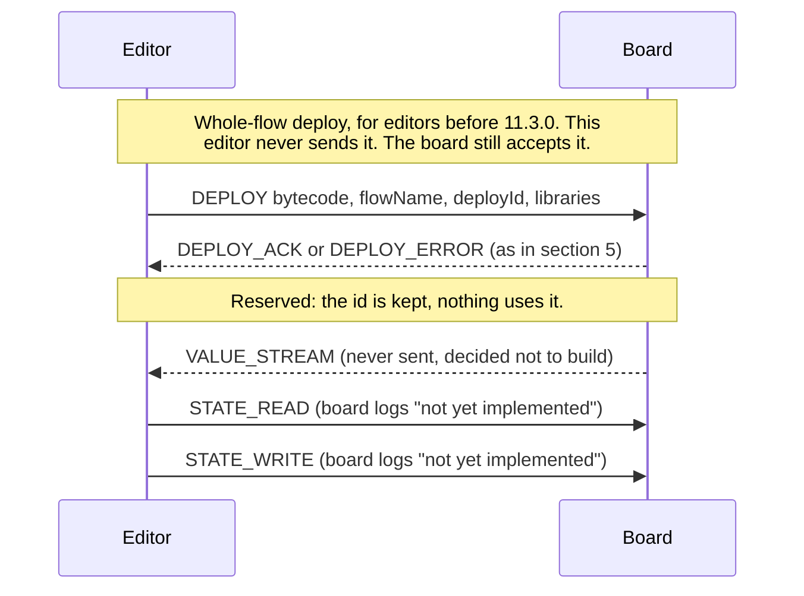
