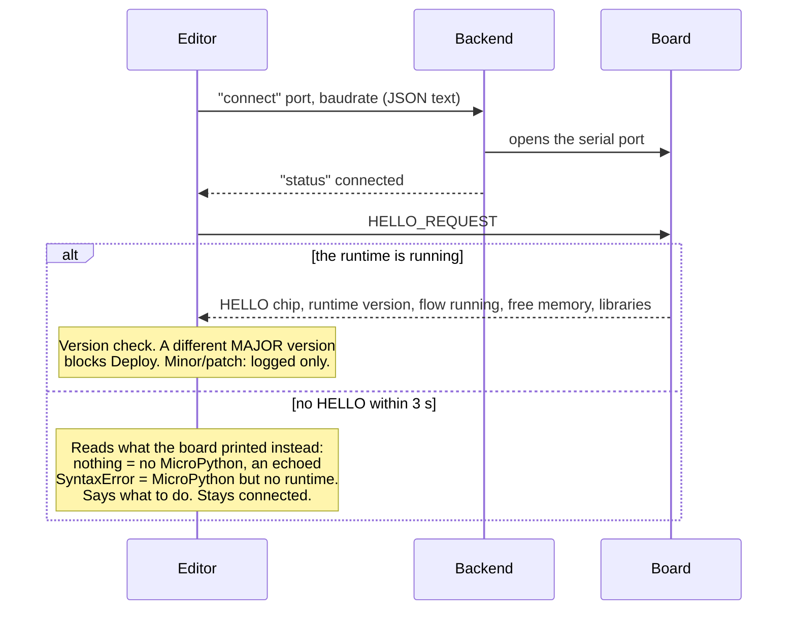
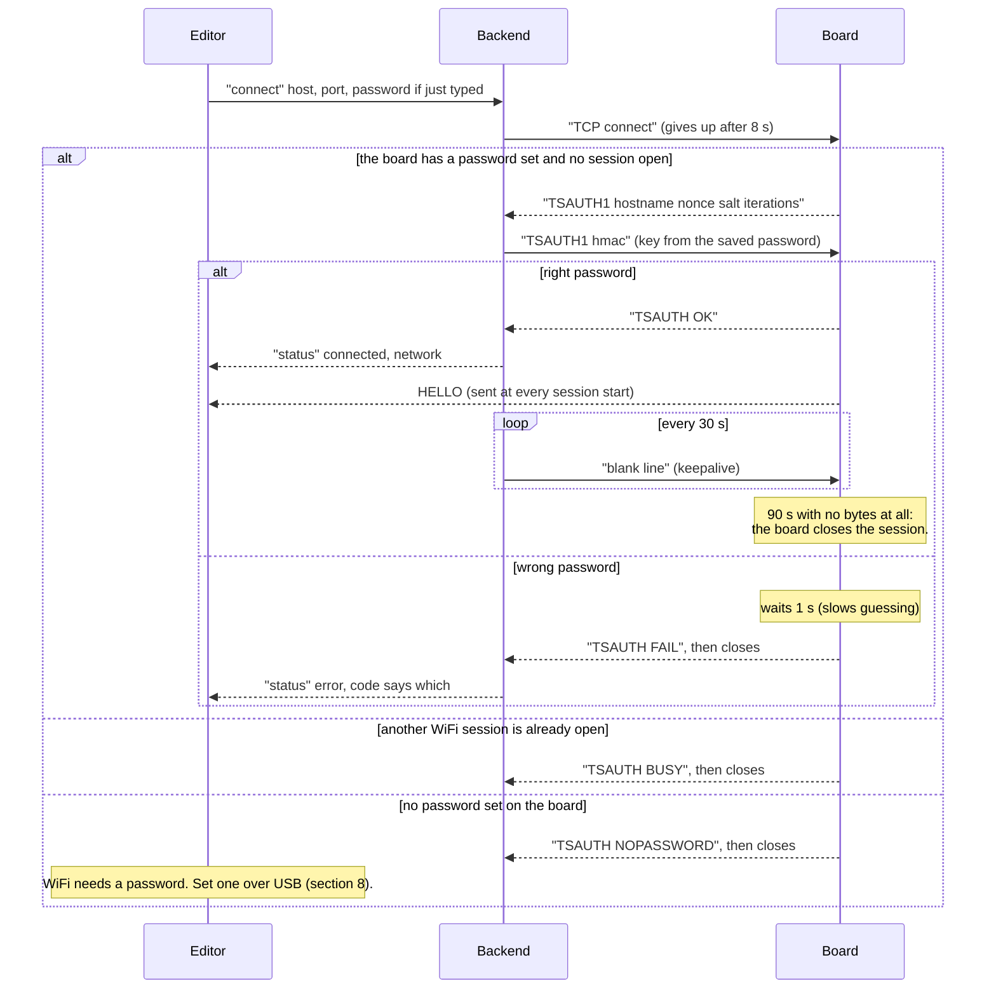
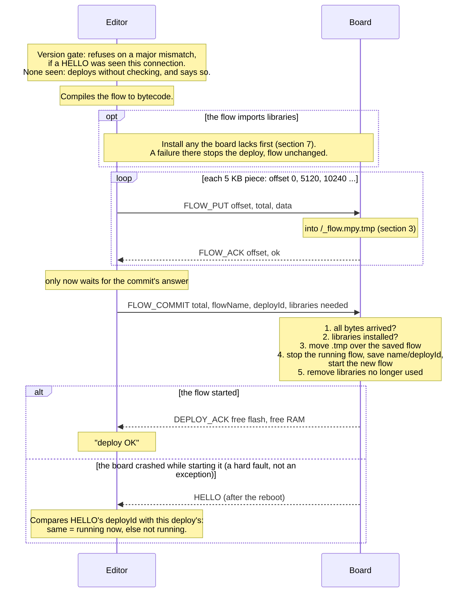
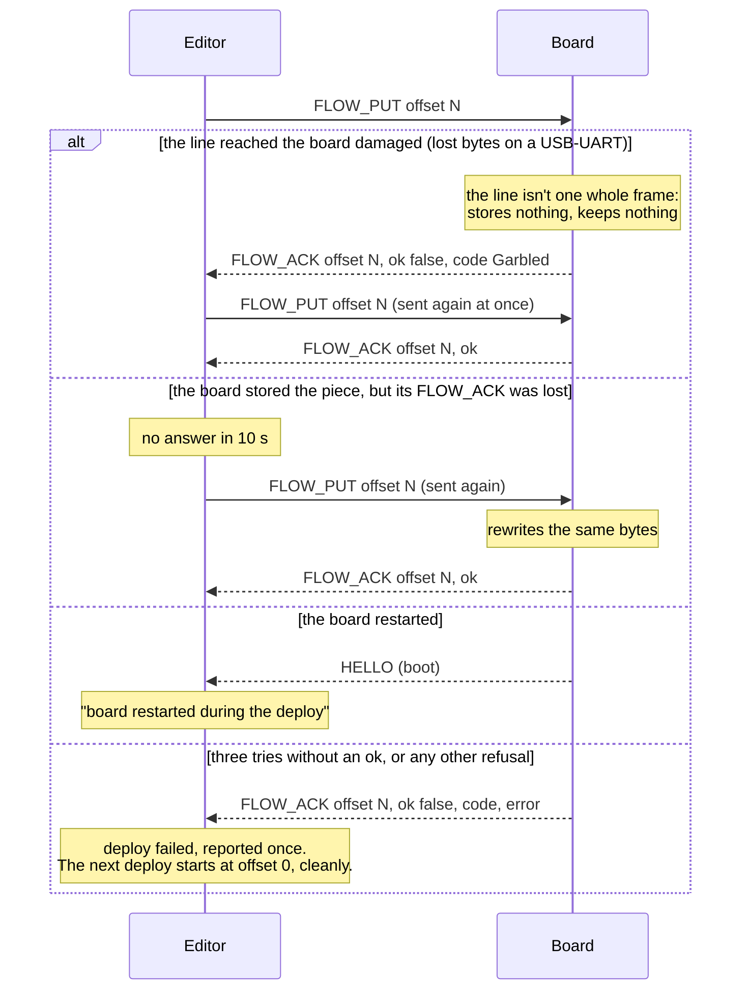
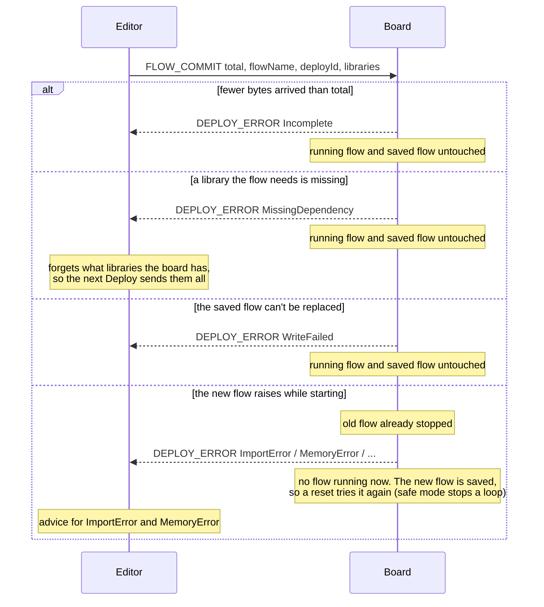
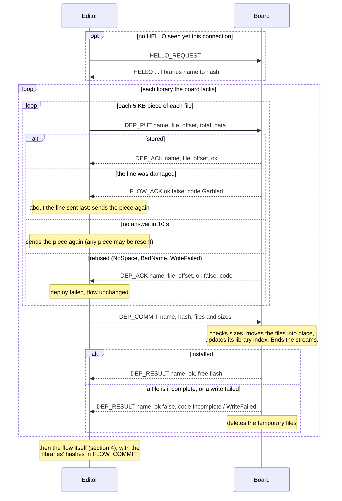
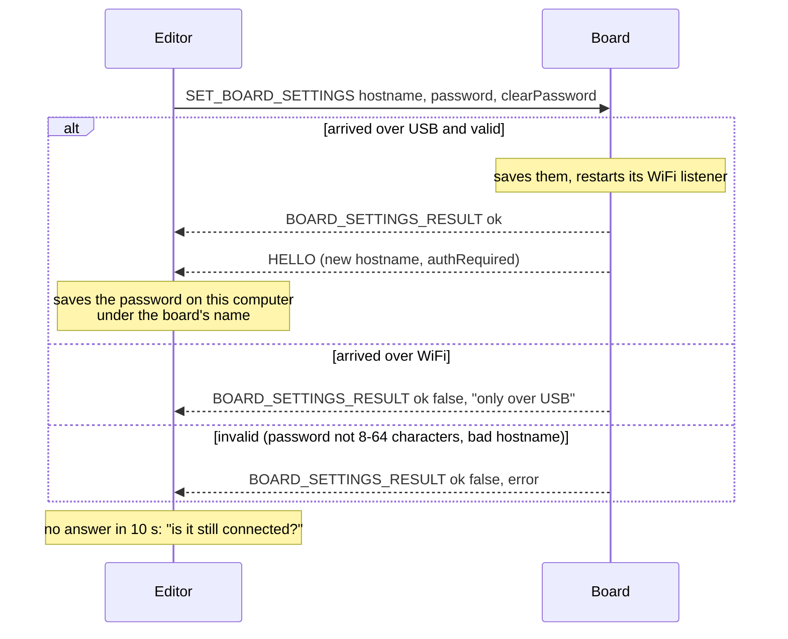
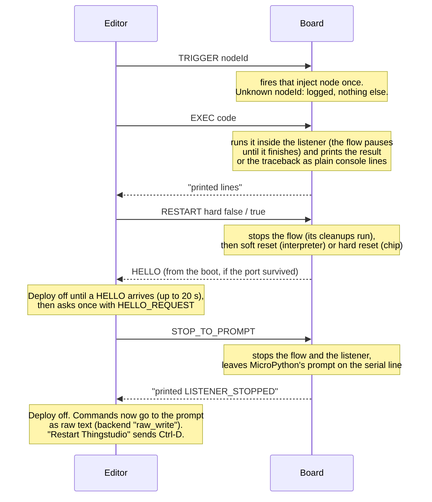
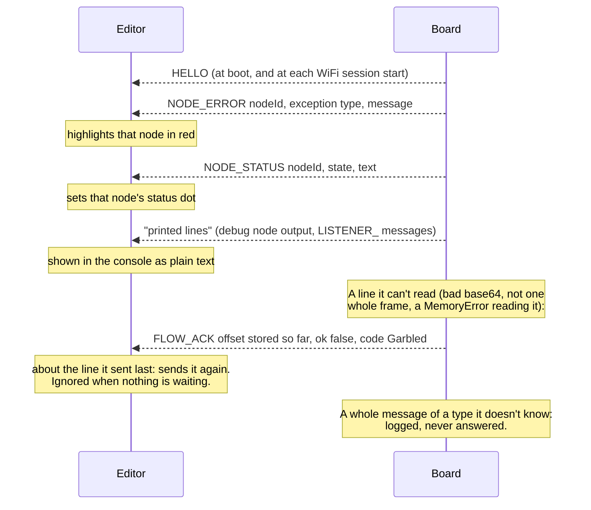
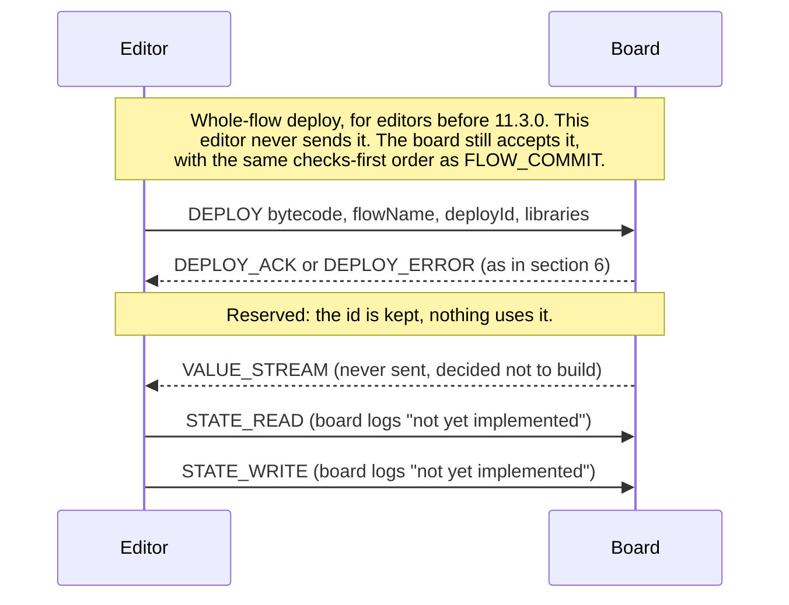

# Wire protocol — exchanges, as diagrams

`SPEC.md` §7 sets the rules for how messages are used together. This file draws them: who sends what, what
answers it, and what happens when something goes wrong. It shows what the code does (editor
`editor/src/protocol/transfer.ts` and `editor/src/app/main.ts`, board `device-runtime/src/listener.py` and
`statemachine.py`, backend `backend/src/thingstudio_backend/{ws_relay,tcp_relay}.py`). Where these diagrams and
`states.json` (the state machines, drawn in `STATES.md`) disagree, the table is right and the diagram is a bug.
The one known limit still open is marked **⚠**.

The diagrams are Mermaid and render on GitHub and in VS Code's Markdown preview.

**Keeping this current.** `tools/protocol_coverage.py` (run by `make test`) fails if a message in
`messages.json` appears in no diagram here, or a diagram names a message that doesn't exist. It can't tell
whether a diagram is *right*: the exchange vectors (`vectors/exchanges.json`) check the behaviour, and this file
should match them. When you change an exchange, change its diagram in the same commit. The convention the
check relies on: on an arrow line, an **unquoted ALL-CAPS first word is a message name**
(`E->>B: FLOW_PUT offset, data`). Anything that isn't a protocol message (backend JSON, the WiFi handshake's
text lines, printed console lines) starts with a quote or lower case.

Participants: **Editor** (the browser app), **Backend** (the local relay, only when connected through it),
**Board** (the listener on the device). The backend moves frames verbatim and never decodes them, so most
diagrams leave it out: an arrow straight from Editor to Board passes through it unchanged.

Contents:

1. [Connect over USB](#1-connect-over-usb)
2. [Connect over WiFi](#2-connect-over-wifi)
3. [A file arriving in pieces: the state machine](#3-a-file-arriving-in-pieces-the-state-machine)
4. [Deploy a flow](#4-deploy-a-flow)
5. [Deploy a flow — when a piece goes wrong](#5-deploy-a-flow--when-a-piece-goes-wrong)
6. [Deploy a flow — when the commit fails](#6-deploy-a-flow--when-the-commit-fails)
7. [Install a library](#7-install-a-library)
8. [Change board settings](#8-change-board-settings)
9. [Commands with no reply](#9-commands-with-no-reply)
10. [Things the board says unasked](#10-things-the-board-says-unasked)
11. [Old and reserved messages](#11-old-and-reserved-messages)

---

## 1. Connect over USB

The board sends a `HELLO` when its listener starts, but the editor has usually not connected yet, so on
Connect the editor always asks for one. No reply within 3 s doesn't stop Connect; the editor works out
from what the board did print what is probably wrong.

Direct WebSerial (no backend) is the same without the backend's two steps.

## 2. Connect over WiFi

Only through the backend. The board speaks first, with a challenge; the password never crosses the
network. One WiFi session at a time. USB stays live alongside it.

⚠ **One editor at a time** (SPEC §7). Everything the board sends goes to USB *and* to the WiFi session, and
replies carry no request id, so an editor on USB and one on WiFi each see the other's replies. The `HELLO` sent
when a WiFi session starts can land in the middle of the other editor's deploy and read as a restart.

## 3. A file arriving in pieces: the state machine

The flow, and each file of a library, arrive the same way: in pieces, each answered. The board keeps one
**stream** per file, always **idle**, **receiving** or **failed**. The machine is `board.stream` in
`states.json`, which is the ground truth; [`STATES.md`](STATES.md) draws it, generated from the table, alongside
`board.listener` and the editor's `editor.transfer`.

Two rules the editor relies on:

- **Any piece may be sent again.** It rewrites the same bytes and is answered `ok`. So when an answer is lost,
  the editor just resends.
- **Offset 0 always starts over**, whatever came before: an abandoned transfer, a refused commit, a failed write.

Anything else is illegal: a gap, a different `total`, a piece that runs past the end, a piece at offset > 0 while
idle. The board announces it (`PROTOCOL_ILLEGAL`, SPEC §7.6) and answers `BadPiece`.

## 4. Deploy a flow

The editor waits up to 30 s for the answer to the commit.

## 5. Deploy a flow — when a piece goes wrong

Each piece gets up to three tries. A resend never changes the piece or the plan.

## 6. Deploy a flow — when the commit fails

The board answers a commit with exactly one `DEPLOY_ACK` or `DEPLOY_ERROR`, and the commit ends the stream
either way. The checks come before anything under a real name changes. Nothing is retried, and the board never
frees memory or restarts by itself to make a retry fit.

A `DEPLOY_ERROR` can also arrive while pieces are still being sent: a piece the board had no memory to read
gets a `Garbled` answer *and* a `DEPLOY_ERROR MemoryError` (the second is for older editors, which sent the
whole flow in one `DEPLOY`). This editor isn't waiting for a commit answer yet, so it only logs that line and
resends the piece.

## 7. Install a library

Before a flow that imports libraries is deployed, the editor compares each library's hash with the list the
board gave in `HELLO` and sends only the missing or changed ones. Same pattern as a flow: 5 KB pieces, each
answered (section 3's rules, one stream per file), then a commit.

## 8. Change board settings

Hostname and WiFi password. **USB only**: the password is what makes a WiFi session trusted, so it can't be
changed over WiFi.

## 9. Commands with no reply

These four have no answering message. What the editor sees is what the board prints, or the `HELLO` after a
restart.

`STOP_TO_PROMPT` is also sent before Install runtime and Remove flow, so the board lets go of the port.

## 10. Things the board says unasked

## 11. Old and reserved messages

