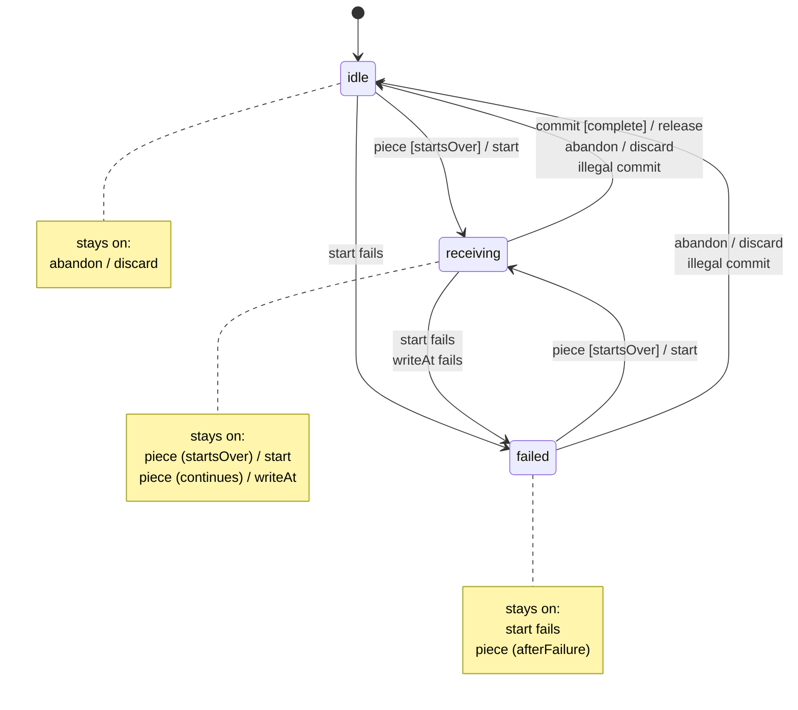
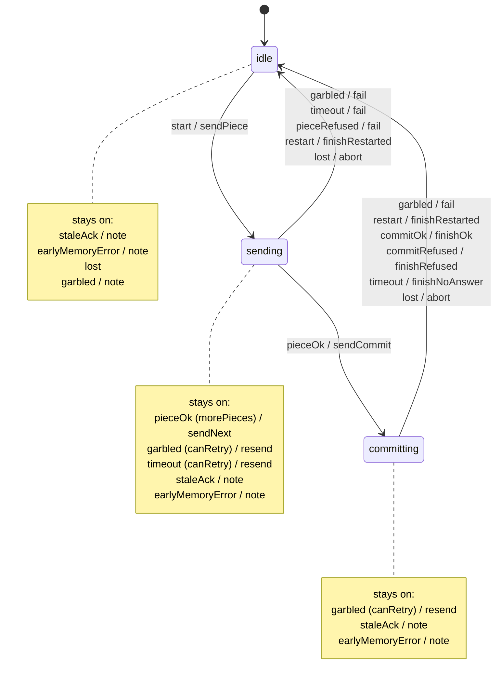

<!-- Generated by tools/protocol_states.py from interfaces/protocol/states.json. Do not edit by hand. -->

# Wire protocol — state machines

The protocol's state machines, generated from `states.json`, which is the ground truth (SPEC §7). Each
side runs its machines straight from that table. To change a machine, edit `states.json`, run
`python3 tools/protocol_states.py`, and update both implementations of any new guard or action.

How to read a table: for an event, the **first** row whose *from* includes the current state and whose
*guard* holds is taken. **Any (state, event) with no row is illegal**: the side running the machine
raises an alert (SPEC §7.6) and then does what the machine's *illegal* rule says.

## `board.listener` (board)

What the board does with each line from the editor. Every editor-to-board message has a row; any other arriving message (one only the board sends, such as DEPLOY_ACK) is illegal. The action runs in the from-state; the state moves after it returns (or to onError when it fails).

| State | Meaning |
|---|---|
| **listening** (initial) | the listener is running |

| # | From | Event | Guard | Action | To | Reply |
|---|---|---|---|---|---|---|
| 1 | listening | `HELLO_REQUEST` |  | sendHello | same | HELLO |
| 2 | listening | `DEPLOY` |  | deployWhole | same | DEPLOY_ACK, DEPLOY_ERROR |
| 3 | listening | `FLOW_PUT` |  | flowPiece | same | FLOW_ACK |
| 4 | listening | `FLOW_COMMIT` |  | flowCommit | same | DEPLOY_ACK, DEPLOY_ERROR |
| 5 | listening | `DEP_PUT` |  | libraryPiece | same | DEP_ACK |
| 6 | listening | `DEP_COMMIT` |  | libraryCommit | same | DEP_RESULT |
| 7 | listening | `TRIGGER` |  | fireTrigger | same | nothing |
| 8 | listening | `EXEC` |  | runExec | same | nothing |
| 9 | listening | `RESTART` |  | restart | same | nothing |
| 10 | listening | `STOP_TO_PROMPT` |  | stopToPrompt | same | nothing |
| 11 | listening | `SET_BOARD_SETTINGS` | overUsb | applySettings | same | BOARD_SETTINGS_RESULT, HELLO |
| 12 | listening | `SET_BOARD_SETTINGS` |  | refuseSettings | same | BOARD_SETTINGS_RESULT |
| 13 | listening | `STATE_READ` |  | ignoreReserved | same | nothing |
| 14 | listening | `STATE_WRITE` |  | ignoreReserved | same | nothing |
| 15 | listening | `unreadable` |  | answerGarbled | same | FLOW_ACK, DEPLOY_ERROR |
| 16 | listening | `unknownType` |  | ignoreUnknown | same | nothing |

**Who answers what**

| Event | The board answers |
|---|---|
| `HELLO_REQUEST` | HELLO |
| `DEPLOY` | DEPLOY_ACK, DEPLOY_ERROR |
| `FLOW_PUT` | FLOW_ACK |
| `FLOW_COMMIT` | DEPLOY_ACK, DEPLOY_ERROR |
| `DEP_PUT` | DEP_ACK |
| `DEP_COMMIT` | DEP_RESULT |
| `TRIGGER` | nothing |
| `EXEC` | nothing |
| `RESTART` | nothing |
| `STOP_TO_PROMPT` | nothing |
| `SET_BOARD_SETTINGS` | BOARD_SETTINGS_RESULT, HELLO |
| `STATE_READ` | nothing |
| `STATE_WRITE` | nothing |
| `unreadable` | FLOW_ACK, DEPLOY_ERROR |
| `unknownType` | nothing |

Generated from the `replies` on these rows (SPEC §7.1); a row without any sends no message. Printed lines (`EXEC` output, `STOP_TO_PROMPT`/`RESTART` notices) are not replies.

**Illegal** (no row matches): alert, then
- any event: state same.

**Events**

- `HELLO_REQUEST`: that message arrived, whole and valid
- `DEPLOY`: that message arrived, whole and valid
- `FLOW_PUT`: that message arrived, whole and valid
- `FLOW_COMMIT`: that message arrived, whole and valid
- `DEP_PUT`: that message arrived, whole and valid
- `DEP_COMMIT`: that message arrived, whole and valid
- `TRIGGER`: that message arrived, whole and valid
- `EXEC`: that message arrived, whole and valid
- `RESTART`: that message arrived, whole and valid
- `STOP_TO_PROMPT`: that message arrived, whole and valid
- `SET_BOARD_SETTINGS`: that message arrived, whole and valid
- `STATE_READ`: that message arrived, whole and valid
- `STATE_WRITE`: that message arrived, whole and valid
- `HELLO`: that message arrived (only the board sends it)
- `DEPLOY_ACK`: that message arrived (only the board sends it)
- `DEPLOY_ERROR`: that message arrived (only the board sends it)
- `VALUE_STREAM`: that message arrived (only the board sends it)
- `NODE_ERROR`: that message arrived (only the board sends it)
- `NODE_STATUS`: that message arrived (only the board sends it)
- `BOARD_SETTINGS_RESULT`: that message arrived (only the board sends it)
- `DEP_RESULT`: that message arrived (only the board sends it)
- `DEP_ACK`: that message arrived (only the board sends it)
- `FLOW_ACK`: that message arrived (only the board sends it)
- `unreadable`: a line the board couldn't read: bad base64, not one whole frame, a body that doesn't decode, or a MemoryError reading it (SPEC §4, §7.1)
- `unknownType`: a whole message of a type this runtime doesn't know (a newer editor)

**Guards**

- `overUsb`: the message arrived over USB serial, not a WiFi session

**Actions**

- `sendHello`: answer HELLO
- `deployWhole`: a whole-flow deploy: the flow stream is discarded, then SPEC §7.3's steps 2-5
- `flowPiece`: hand the piece to the flow's board.stream
- `flowCommit`: hand the commit to the flow's board.stream, then SPEC §7.3's steps 2-5
- `libraryPiece`: hand the piece to that library file's board.stream (after checking the names, and the free space for a first piece)
- `libraryCommit`: hand the commit to each of the library's file streams, then install it
- `fireTrigger`: fire that inject node once (an unknown node id is logged)
- `runExec`: run the code in the listener, printing its result or traceback
- `restart`: stop the flow, then soft or hard reset
- `stopToPrompt`: stop the flow and the listener, leaving MicroPython's prompt
- `applySettings`: save the hostname/password; answer the result, then a HELLO if it worked
- `refuseSettings`: answer that settings can only be changed over USB
- `ignoreReserved`: log that the message is reserved and not implemented
- `answerGarbled`: answer FLOW_ACK Garbled for the flow bytes stored so far (and DEPLOY_ERROR MemoryError if that was the cause)
- `ignoreUnknown`: log the type and drop it

## `board.stream` (board)

One file arriving in pieces: the flow, or one file of a library. Any piece may be sent again (it rewrites the same bytes); a piece at offset 0 always starts over; a commit ends the stream whatever the outcome. The action runs in the from-state; the state moves after it returns (or to onError when it fails).

Runs as:

- **flow**: piece = `FLOW_PUT`, its answer = `FLOW_ACK`, commit = `FLOW_COMMIT`, a refused commit = `DEPLOY_ERROR`.
- **library**: piece = `DEP_PUT`, its answer = `DEP_ACK`, commit = `DEP_COMMIT`, a refused commit = `DEP_RESULT`.

| State | Meaning |
|---|---|
| **idle** (initial) | nothing under way |
| **receiving** | `stored` bytes are in the temporary file, out of `total` |
| **failed** | writing failed; the temporary file is gone; the failure's code and text are kept |

| # | From | Event | Guard | Action | To | Reply |
|---|---|---|---|---|---|---|
| 1 | any | `piece` | startsOver | start | receiving | ack ok true |
| | | | | *start fails* | failed | ack ok false, code $error |
| 2 | receiving | `piece` | continues | writeAt | receiving | ack ok true |
| | | | | *writeAt fails* | failed | ack ok false, code $error |
| 3 | failed | `piece` | afterFailure |  | failed | ack ok false, code $failure |
| 4 | receiving | `commit` | complete | release | idle |  |
| 5 | any | `abandon` |  | discard | idle |  |

**Illegal** (no row matches): alert, then
- `piece`: state same, reply ack ok false, code BadPiece.
- `commit`: discard, state idle, reply commitError code Incomplete.

**Events**

- `piece`: a piece arrived: `offset`, `total`, `data`
- `commit`: the commit arrived, naming the `total` (size) it expects
- `abandon`: the board drops the transfer under way: a whole DEPLOY replaces it

**Guards**

- `startsOver`: offset is 0, and the piece fits: len(data) <= total
- `continues`: 0 < offset <= stored, total is the stream's total, and offset + len(data) <= total
- `afterFailure`: offset > 0
- `complete`: the commit's total is the stream's total, and stored == total

**Actions**

- `start`: empty the temporary file and write the piece; stored = len(data), total = total. Fails with NoSpace or WriteFailed (and, for a library, NoSpace when the first piece's total won't fit in free flash)
- `writeAt`: write the piece at offset (a resend rewrites the same bytes); stored = max(stored, offset + len(data)). Fails with NoSpace or WriteFailed
- `release`: the owner takes the temporary file (SPEC §7.3 moves it into place); back to nothing under way
- `discard`: remove the temporary file

## `editor.transfer` (editor)

The editor sending a flow or a library: each piece answered before the next, then the commit, then its one answer. One instance per connection; it sits in idle between transfers and still checks what arrives. The action runs in the from-state; the state moves after it returns (or to onError when it fails).

| State | Meaning |
|---|---|
| **idle** (initial) | no transfer under way |
| **sending** | a piece has been sent; waiting for its answer (up to pieceTimeoutMs) |
| **committing** | the commit has been sent; waiting for its answer (up to commitTimeoutMs) |

| # | From | Event | Guard | Action | To | Reply |
|---|---|---|---|---|---|---|
| 1 | idle | `start` |  | sendPiece | sending |  |
| 2 | sending | `pieceOk` | morePieces | sendNext | sending |  |
| 3 | sending | `pieceOk` |  | sendCommit | committing |  |
| 4 | sending, committing | `garbled` | canRetry | resend | same |  |
| 5 | sending, committing | `garbled` |  | fail | idle |  |
| 6 | sending | `timeout` | canRetry | resend | sending |  |
| 7 | sending | `timeout` |  | fail | idle |  |
| 8 | sending | `pieceRefused` |  | fail | idle |  |
| 9 | sending, committing | `restart` |  | finishRestarted | idle |  |
| 10 | committing | `commitOk` |  | finishOk | idle |  |
| 11 | committing | `commitRefused` |  | finishRefused | idle |  |
| 12 | committing | `timeout` |  | finishNoAnswer | idle |  |
| 13 | any | `staleAck` |  | note | same |  |
| 14 | any | `earlyMemoryError` |  | note | same |  |
| 15 | sending, committing | `lost` |  | abort | idle |  |
| 16 | idle | `lost` |  |  | same |  |
| 17 | idle | `garbled` |  | note | same |  |

**Illegal** (no row matches): alert, then
- any event: state same.

**Events**

- `start`: the editor starts a transfer (a list of pieces and a commit)
- `pieceOk`: FLOW_ACK/DEP_ACK answering the piece sent last, ok
- `pieceRefused`: FLOW_ACK/DEP_ACK answering the piece sent last, not ok, any code but Garbled
- `garbled`: FLOW_ACK with code Garbled: the board couldn't read the line sent last (SPEC §7.1)
- `staleAck`: FLOW_ACK/DEP_ACK for a piece already answered (a late answer to a piece that was resent)
- `strayAck`: FLOW_ACK/DEP_ACK for no piece of this transfer or the last one
- `commitOk`: DEPLOY_ACK, or DEP_RESULT ok for this library, while committing
- `commitRefused`: DEPLOY_ERROR, or DEP_RESULT not ok for this library, while committing
- `earlyMemoryError`: DEPLOY_ERROR MemoryError straight after a Garbled answer: the second half of the board's answer to a line it couldn't read (SPEC §7.1), not a commit's answer
- `strayResult`: DEPLOY_ACK, DEP_RESULT, or another DEPLOY_ERROR, with no commit waiting for it
- `restart`: a HELLO the editor didn't ask for (no HELLO_REQUEST pending): the board restarted
- `timeout`: the state's wait ran out
- `lost`: the connection to the board closed

**Guards**

- `morePieces`: the piece just answered isn't the last
- `canRetry`: fewer than pieceRetries resends of this line so far

**Actions**

- `sendPiece`: send the first piece
- `sendNext`: send the next piece
- `sendCommit`: send the commit
- `resend`: send the same line again (any piece may be resent, SPEC §7.2; a Garbled commit was never read)
- `fail`: end the transfer at the line sent last: the board's code, or Timeout, or Garbled after the last try
- `finishRestarted`: end the transfer: the board restarted (its HELLO says what is running)
- `finishOk`: end the transfer: deployed, or installed
- `finishRefused`: end the transfer: refused, with the board's code
- `finishNoAnswer`: end the transfer: no answer to the commit
- `abort`: end the transfer: the connection closed (the caller reports the disconnect)
- `note`: log it, change nothing
